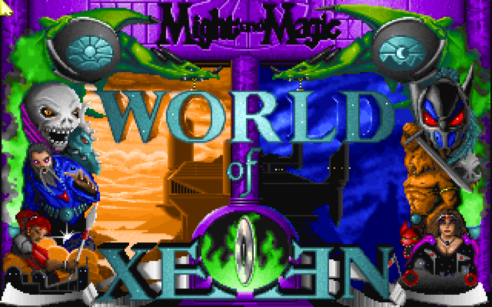

# WoX — a native reconstruction of World of Xeen



## Why this project exists

About a month ago I thought to myself: I'd like to play *World of Xeen* one more time.

I first played it in the 1990s. Everything about it captivated me, I spent a huge amount of time in it, and I had a
great time. Over the following years I came back to it perhaps three more times.

Until now: after an hour of play I remembered how long it takes to go through the inventory (identifying items),
how long it takes to scroll through the spells, and how disorienting it can be to see only a small piece of the map...

And that is where the idea came from. We live in the age of AI, and everyone is reverse engineering everything, so
why not me? On top of that, **I could extend the game with whatever came to mind while playing**.

And that is how this project started.

## What it is

**WoX** (`wox`) is an unofficial, native C11 reconstruction of **Might and Magic: World of Xeen** — the combined game formed
by *Might and Magic IV: Clouds of Xeen* and *Might and Magic V: Darkside of Xeen* (DOS, New World Computing, 1993).
It runs on **Windows** and **Linux** using the game files from your own copy of the original game. No game files are
included in this repository.

Two programs are built:

| Program | What it does |
|---|---|
| `wox` (`wox.exe`) | The game: the reconstructed engine (exploration, events, towns, combat, magic, saving and loading, both worlds and the endings) together with the intro and ending movies of the original launcher (`XEEN.EXE`), in one native window with native audio. |
| `setup` (`setup.exe`) | A small settings tool that writes the game's own configuration (`XEEN.CFG`: speech, music card) and `wox.cfg` (folders, display, optional enhancements). Native Win32 on Windows, GTK 3 on Linux. It is not part of the original game. |

### Add-ons and bug fixes

Besides the faithful game, WoX offers optional **add-ons**: quality-of-life features that are *not* part of the
original game, many of them aimed at exactly the chores that inspired this project. **All of them are off by
default**, so without changing anything you play the original game. Turn them on one by one in `wox.cfg`
(`[addons]` section, `name = on`), all at once (except `damage_numbers.stack`) by choosing "Enhanced version" in `setup`'s first run, or for one
session with `--addon NAME` on the command line.

| Add-on | What it does |
|---|---|
| `identify` | Identified item types show their statistics in the item lists (remembered per save slot). |
| `map_movement` | The map (M) pans with the arrow keys and by dragging with the mouse; a click inside it no longer closes it. |
| `world_map` | In the map (M), W or a World Map button shows the whole world's surface on one screen (only what you have explored), with panning and zoom. |
| `town_icons` | Icons mark the town services (blacksmith, tavern, temple, guild, training, bank, mirror, tents, ...) and the Skyroad's tents on the map and the minimap once you have seen them. |
| `wizard_eye_plus` | While Wizard Eye is on, the cells you have not seen yet are shown through a checkerboard on the minimap instead of being hidden (style selectable for indoor, outdoor and sky maps). |
| `quest_journal` | In the Quests dialog (V) quest items are numbered and get a description; together with `world_map`, a quest's or note's place can be shown on the world map. |
| `spell_short_description` | While casting, a small box describes the selected spell. |
| `spell_list_sort` | A button switches a character's spell lists between A–Z and grouped by type (remembered per save slot). |
| `mouse_scroll` | The mouse wheel scrolls the spell lists, the Quests panel, the Awards and the inn's roster. |
| `character_details` | In the character view, the stat pop-ups explain what a value does; clicking a skill or condition explains it. |
| `training_preview` | At the training grounds a Prev button (P) shows the levels a character can train to now, their cost and what stops further training. |
| `damage_numbers` | Damage (red), healing (green) and misses appear over the portraits and the monsters, in exploration and in combat (`damage_numbers.stack`: one running total per target). |
| `monster_difficulty` | An icon over each monster in the 3D view shows how dangerous it is for your party. |
| `please_wait_skip` | The "Please Wait..." box shown while a map loads is skipped. |

**Bug fixes** correct errors of the original game. They are also off by default, because the original behaviour is
the reference. Turn them on in `wox.cfg` (`[bugfix]`) or with `--bugfix NAME`:

| Bug fix | What it corrects |
|---|---|
| `spell_description` | Wrong spell descriptions in the guild (damage, targets and effects; permanent downsides shown in red). |
| `left_clip_colors` | Monsters and objects cut off by the 3D view's left edge showed a few stray pixels. |
| `sprite_width_trim` | Shrunk pictures drew one extra column (e.g. the castle zoom). |
| `quest_up_down` | U and D now scroll the Quests dialog as its Up and Down buttons say. |

Details of every setting: [docs/CONFIGURATION.md](docs/CONFIGURATION.md).

## How it was made

The original program was studied by reverse engineering: static analysis of the original DOS executables, made
possible by [REA: Reverse Engineer Anything](https://github.com/morluto/rea) and
[Ghidra](https://github.com/NationalSecurityAgency/ghidra), and **differential testing** in which the original program's own machine code was executed in a CPU emulator
(Unicorn) on the same inputs as the native code, comparing game state, random-number use and screen output. The
behaviour found that way was then written as new, portable C11 code, routine by routine, and checked with
regression tests and manual play. All of the code was written by AI coding agents, **OpenAI Codex and Anthropic's Claude
Code**, under the direction of the project owner.

This is **not** an emulator: the game's original machine code is not executed when you play. It is also not an
official port, it is not a recovered original source code, and it was not developed as a "clean-room"
reimplementation: the developers studied the original program directly. Other projects (notably ScummVM's Xeen
engine) were occasionally consulted as hypotheses, never as the authority.

## Fidelity

The goal is that the game **behaves like the original**: the same rules and formulas, user interface, texts, maps
and events, original data formats and save files (`*.WOX`, `XEEN.CFG`), timing-dependent behaviour, random-number
sequences, sound and music driver behaviour, and the original's quirks and bugs, wherever these could be established
from the original program.

That includes the original bugs: typing **&** at a mirror, or using a Town Portal item during combat, crashes the
game exactly as it did in 1993. Even the hidden debug display is there: in the Control Panel, press **G**, **O**,
**B**, **R** one after another. (Optional bug fixes for some original defects are described below; they are off by
default.)

What is necessarily different:

- graphics, keyboard and mouse input, audio output, files and timers use the host operating system (X11 on Linux,
  Win32 on Windows; audio through SDL 2) instead of VGA, BIOS and DOS hardware;
- music cards are reproduced by emulators: Roland MT-32 (Munt), Roland SC-55 / Sound Canvas (Nuked-SC55),
  AdLib / Sound Blaster OPL2 (ymfm), or your system's MIDI device; the Roland emulators need ROM images you supply;
- the DOS installer is replaced by `setup`; window, scale, full-screen and folder settings live in `wox.cfg`;
- a map-loading "Please Wait..." box is held on screen for 200 ms because native loading is instantaneous;
- **optional enhancements** ("add-ons", for example item statistics on identified items, a world map, a quest
  journal, damage numbers) and **optional bug fixes** for some of the original's own defects. **All of them are off
  by default.** They are switched on individually in `wox.cfg` (`[addons]`, `[bugfix]`), with `--addon NAME` /
  `--bugfix NAME`, or all at once by choosing "Enhanced version" in `setup`'s first run ("Vanilla version" keeps
  the original behaviour).

How well this is verified: during development, each feature was compared with the original program where possible,
and a full regression run of the development test suite (296 of 296 historical original-versus-native comparison
steps and 408 of 408 unit tests in each of three build configurations, with no discrepancy found) passed on the
development tree of 24 November 2026. **Later changes have not received that full regression**, and this public
source tree has only been checked with the smaller public test set described under [Tests](#tests). Not every
path of the original could be compared: untested situations, remaining differences and bugs are to be expected.
Please report them (see [Reporting problems](#reporting-problems)).

## What you need to play

- **Your own legally obtained copy of World of Xeen.** Both the CD-ROM release and the GOG.com release of *Might and
  Magic 4-5* work. For **building**, use the CD's `GAME\XEEN.DAT`, or, from a GOG.com installation,
  `WORLD\XEEN.DAT` (not the `XEEN.DAT` in the installation's main folder, which is a different build). The floppy release lacks files the game needs (for example the World of Xeen title animation) and
  is not supported.
- From it: `XEEN.CC` and `DARK.CC` (required), `INTRO.CC` (the intro and ending movies and the music drivers),
  `XEEN.CFG` (the game's sound configuration; `setup` can create one) and your saves (`XEENnn.WOX`/`DARKnn.WOX`).
  Instead of the loose files, a disc image named `GAME1.GOG` or `GAME2.GOG` in the data folder is read directly
  (the GOG release's images; an ISO 9660 or raw mode-1 image of the original CD renamed so also works).
- To **build** the game: the original `XEEN.DAT` from the same copy, once (see [Building](#building)).
- Optional: Roland **MT-32** ROMs (`MT32_CONTROL.ROM`, `MT32_PCM.ROM`) and/or **SC-55** ROMs for the Roland music
  options, and Ogg Vorbis rips of the CD's audio tracks for the CD speech/music. None of these are included; you
  must obtain them yourself where you are legally allowed to.

### First run

1. Put `wox`, `setup` and the music libraries of the package (Linux: `libxeen_sbpro.so.1`, `libxeen_sc55.so.1`,
   `libmt32emu.so.2`; Windows: `xeen_sbpro.dll`, `xeen_sc55.dll`, `xeen_mt32.dll`) in one folder, for example your
   game folder.
2. Run `setup`. Its first run asks "GOG version" or "Other version" (where your data, saves and `XEEN.CFG` are)
   and "Vanilla version" (original behaviour) or "Enhanced version" (all enhancements on). Then choose the music
   card, speech, display and folders, and **Save**.
3. Run `wox` (from the game folder, or with `--data-dir DIR`). The original intro plays, then the main menu.

Without `setup`, the first `wox` start creates a default `wox.cfg` beside the executable (on Windows after asking).
The full reference is [docs/CONFIGURATION.md](docs/CONFIGURATION.md): command-line options, every `wox.cfg` key,
music and speech choices, ROM and CD-track folders, disc images, saves, and what happens when the game stops.

`wox --version` prints the version and exits. On Windows `wox.exe` is a GUI program, so its text output is visible
only through a redirection: `wox.exe --version > version.txt`.

## Building

The tested build host is **Ubuntu 24.04 (on WSL2)** with GCC 13.3, CMake 3.28 and Python 3.12. Linux binaries are
built natively; **Windows binaries are cross-compiled with MinGW-w64** (GCC 13, win32 thread model) on that Linux
host. A native Windows build (MSVC or MSYS2) has **not** been tried. Step-by-step details, options and the package
contents are in [docs/BUILDING.md](docs/BUILDING.md); the short version:

```sh
# 1. Tools (Ubuntu/Debian)
sudo apt install build-essential cmake python3 python3-venv pkg-config git curl \
                 libx11-dev libgtk-3-dev libsdl2-dev libasound2-dev libpulse-dev
sudo apt install gcc-mingw-w64-x86-64-win32 g++-mingw-w64-x86-64-win32 binutils-mingw-w64-x86-64  # Windows

# 2. Program data from YOUR copy of the game (once; see src/data/README.md)
mkdir -p build && tools/data/unpack_xeen_dat.sh /path/to/XEEN.DAT build/XEEN.unpacked.DAT   # CD: GAME\XEEN.DAT; GOG: WORLD\XEEN.DAT
python3 -m venv build/venv && build/venv/bin/pip install capstone
build/venv/bin/python -B tools/data/extract_program_data.py --xeen-dat build/XEEN.unpacked.DAT \
    --out src/data --meta build/program-data-meta

# 3. Pinned third-party sources (SDL 2.30.11, Munt 2.8.3, ymfm, Nuked-SC55) into deps/
tools/deps/fetch_deps.sh

# 4. Packages
tools/linux/package.sh        # -> build/linux-package/dist/
tools/windows/package.sh      # -> build/windows-package/dist/   (MinGW-w64 cross-build)
```

The program data in `src/data/` is generated from the original game and is ignored by Git: **do not commit or
redistribute it**. The game ships `XEEN.DAT` compressed with PKLITE; `tools/data/unpack_xeen_dat.sh` unpacks it with
[deark](https://github.com/jsummers/deark) (downloaded and built the first time, a build-time tool only) and checks
that the result is exactly the expected file.

### Release archives

```sh
tools/release/make_release.py --build    # -> build/release/wox-VERSION-windows-x64.zip, wox-VERSION-linux-x64.tar.gz
```

Each archive holds the programs and their libraries at the top, and an `extras/` folder with the README, the user
documentation, the licences, the complete source of this version and the exact sources of the bundled third-party
libraries (what the GPL requires to accompany the binaries). Details: [docs/BUILDING.md](docs/BUILDING.md).

### Tests

```sh
cmake -S . -B build/dev -DCMAKE_BUILD_TYPE=Release
cmake --build build/dev -j
ctest --test-dir build/dev --output-on-failure
```

The public test set (75 tests) consists of headless unit and contract tests: they need the generated program data
but no game files, ROMs, display or sound device. The development project's much larger regression suite compares
the native code with the original program and needs the original files, so it is not part of this repository.

## Versions

Each program has its own version number, written once in [`versions.cmake`](versions.cmake) (both are `1.0.0`).
See [docs/VERSIONING.md](docs/VERSIONING.md).

## Future plans

- Support for CD images in BIN/CUE format.
- More add-ons: an icon for broken equipment, notes on the map, and protection against buying a spell or skill a
  character already has.
- Further refactoring of the code.

## Known limitations

- Building needs `XEEN.DAT` from the CD-ROM release or the GOG.com release (`WORLD\XEEN.DAT`); other releases have
  not been checked (see [src/data/README.md](src/data/README.md)).
- Windows binaries are cross-compiled and have not been tested from a native Windows build environment.
- The Roland MT-32 / SC-55 music options need ROM images that are not included.
- The floppy release is not supported. Other language versions have not been tested.
- macOS is not supported.
- Where the native engine meets a situation it cannot reproduce faithfully, it stops with a message instead of
  guessing (see "When the game stops" in [docs/CONFIGURATION.md](docs/CONFIGURATION.md)). Please report such stops.

## Troubleshooting

- **CMake: "Program data missing"** — generate `src/data` first (step 2), or pass `-DXEEN_PROGRAM_DATA_DIR=DIR`.
- **"not the protected unpacked XEEN.DAT (size/SHA-256 differ)"** — unpack it first with
  `tools/data/unpack_xeen_dat.sh`; if that refuses your file too, your copy is a different release: please report it.
- **No music** — check the music choice in `setup`, the ROM folders for MT-32/SC-55, and that `INTRO.CC` is present;
  the reason is written to `wox.log` (beside the executable; its second line names the file in use).
- **"Cannot read ... (possible floppy/CD-ROM version mismatch)"** — use the CD-ROM release's archives.
- **Nothing visible from `wox.exe --version`** — redirect the output (see above).

## Development

- [CONTRIBUTING.md](CONTRIBUTING.md) — reporting bugs and proposing changes.
- [docs/DEVELOPING.md](docs/DEVELOPING.md) — how the source is organised, generated files, tests.
- [docs/SOURCE_ARCHITECTURE.md](docs/SOURCE_ARCHITECTURE.md) and [docs/CODING_STYLE.md](docs/CODING_STYLE.md).
- [THIRD_PARTY_NOTICES.md](THIRD_PARTY_NOTICES.md) — bundled and fetched third-party code.

## Reporting problems

Please use the **Issues** page of this repository (the bug-report form asks for what is needed). Include the version
(`wox --version`), the operating system, your `wox.cfg`, the `wox.log` written beside the executable, and how to
reproduce the problem; for a stop, quote its "Technical details" line. Please do not attach game files, saves you do
not own, or ROM images.

## Still reading this?

Then try the modern version of the [boss key](https://en.wikipedia.org/wiki/Boss_key): press **F10** while playing.

## Licence

The code written for this project is licensed under the **GNU General Public License, version 3 or (at your
option) any later version** (SPDX `GPL-3.0-or-later`) — see [LICENSE](LICENSE). Third-party
components keep their own licences, listed in [THIRD_PARTY_NOTICES.md](THIRD_PARTY_NOTICES.md) with their texts in
[LICENSES/](LICENSES/). The program icons (`icon/`) were created for this project with ChatGPT (OpenAI) and are
offered under the same terms.

This program is distributed in the hope that it will be useful, but **without any warranty**; without even the
implied warranty of merchantability or fitness for a particular purpose. See the GNU General Public License for
details.

## Legal status and disclaimer

This is an independent, unofficial fan project. It is not affiliated with, endorsed by or supported by the holders
of the rights to Might and Magic or World of Xeen (originally New World Computing; the Might and Magic brand is
currently owned by Ubisoft) or by GOG.com. "Might and Magic", "World of Xeen" and related names are trademarks of
their respective owners and are used here only to describe what this software works with.

The original game, its program, data, texts, graphics, music and other assets remain the property of their
respective rights holders. They are not included in this repository, and you need your own copy of the game to
play. Note that the ready-built programs in the release archives contain, compiled in, the program data the engine
needs from the original `XEEN.DAT` (texts and tables); the game's graphics, sound, maps and other files are never
included.
The licence above covers only the rights the project's authors hold in their own work; it does not grant any rights
in the original game. This notice does not settle every legal question about this project.
